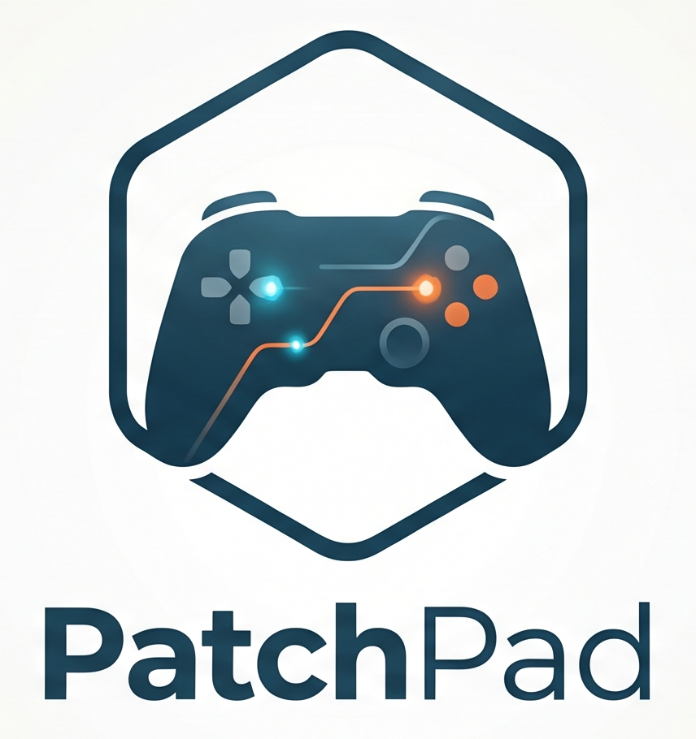

<p align="center"></p>

# PatchPad

Testeur de manettes multiplateforme de la suite open source **Patchbay's**
(PatchTime, PatchNode, PatchProbe). Cœur en Rust, interface Tauri v2.
macOS (Apple Silicon), Windows 10/11, Linux x86_64. Licence GPL-3.0.

[Français](#français) · [English](#english)

---

## Français

### Fonctionnalités

- **Liste des manettes** connectées : nom, connexion (USB, Bluetooth, adaptateur), batterie.
- **Vue schématique** (dessin maison, sans visuel Sony ni Microsoft) : boutons qui s'allument,
  sticks avec position et trace, gâchettes en barres analogiques, doigts sur le pavé tactile.
- **Sticks** : nuage de points, contour mesuré et score de circularité, valeur au repos,
  diagnostic de drift avec seuil réglable, zone morte conseillée, course des gâchettes.
- **Pavé tactile** (DS4) : canevas aux proportions du pavé (1920 × 942), deux doigts colorés
  avec trace, clic du pavé.
- **Mouvement** (DS4) : courbes défilantes gyroscope (°/s) et accéléromètre (g) sur 3 axes,
  indicateur d'orientation (filtre complémentaire), bouton « recalibrer le zéro ».
- **Sorties** : vibration gauche / droite / les deux avec intensité et durée, couleur de la
  barre lumineuse (DS4). Bouton grisé avec infobulle quand l'OS ne le permet pas.
- **Bas de page** : fréquence de rapport en Hz (avec gigue et pire intervalle), journal des
  derniers événements.
- **Rapport** : session de test guidée qui coche automatiquement chaque bouton appuyé et
  chaque vérification (bord des sticks, drift, course des gâchettes, doigts sur le pavé,
  mouvement, gravité), avec confirmation manuelle des sorties (vibration, barre lumineuse).
  Export en **PDF** ou en **HTML** autonome : résumé réussi / échec / non testé, valeurs
  mesurées, nombre d'appuis par bouton et schémas des sticks.
- Thème clair / sombre selon le système, interface en français et en anglais.

### Manettes prises en charge

| Manette | Identifiants | Backend |
|---|---|---|
| DualShock 4 v1 | `054c:05c4` | hidapi (rapports HID bruts) |
| DualShock 4 v2 | `054c:09cc` | hidapi |
| Adaptateur sans fil DS4 | `054c:0ba0` | hidapi |
| Xbox One / Series (tous modèles) | `045e:*` | gilrs |
| Autres manettes reconnues par l'OS | — | gilrs (fonctions de base) |

Le backend DS4 a la priorité : une DualShock 4 ouverte par hidapi n'apparaît pas une seconde
fois via gilrs. Si hidapi ne peut pas l'ouvrir (règle udev absente sous Linux), elle reste
visible via gilrs, en mode générique.

### Matrice de support

✅ pris en charge · ⚠️ dépend du pilote · ❌ impossible sur cette plateforme · — sans objet

Cette matrice décrit ce que le code implémente ; elle reste à confirmer manette en main sur
chaque plateforme.

**DualShock 4** (hidapi)

| Fonction | macOS USB | macOS BT | Windows USB | Windows BT | Linux USB | Linux BT |
|---|---|---|---|---|---|---|
| Boutons, sticks, gâchettes | ✅ | ✅ | ✅ | ✅ | ✅ ¹ | ✅ ¹ |
| Pavé tactile (2 doigts + clic) | ✅ | ✅ | ✅ | ✅ | ✅ ¹ | ✅ ¹ |
| Gyroscope, accéléromètre (calibrés) | ✅ | ✅ | ✅ | ✅ | ✅ ¹ | ✅ ¹ |
| Batterie, câble branché | ✅ | ✅ | ✅ | ✅ | ✅ ¹ | ✅ ¹ |
| Vibration | ✅ | ✅ | ✅ | ✅ | ✅ ¹ | ✅ ¹ |
| Barre lumineuse | ✅ | ✅ | ✅ | ✅ | ✅ ¹ | ✅ ¹ |
| Fréquence de rapport | matérielle | matérielle | matérielle | matérielle | matérielle | matérielle |

¹ Avec la règle udev (voir plus bas). Sans elle, la manette passe par gilrs/evdev : boutons,
sticks, gâchettes et vibration seulement.

**Xbox One / Series** (gilrs)

| Fonction | macOS USB | macOS BT | Windows USB | Windows BT | Linux USB | Linux BT |
|---|---|---|---|---|---|---|
| Boutons, sticks, gâchettes | ❌ ² | ✅ | ✅ | ✅ | ✅ (`xpad`) | ✅ (`hid-microsoft`) |
| Bouton Xbox | ❌ ² | ✅ | ❌ ³ | ❌ ³ | ✅ | ✅ |
| Vibration | ❌ ² | ❌ ⁴ | ✅ | ✅ | ⚠️ ⁵ | ⚠️ ⁵ |
| Moteurs des gâchettes | ❌ | ❌ | ❌ ⁶ | ❌ ⁶ | ❌ | ❌ |
| Batterie | — | ❌ ⁴ | ✅ | ✅ | ⚠️ | ⚠️ |
| Gyroscope, pavé tactile | — | — | — | — | — | — |
| Fréquence | changements | changements | changements | changements | changements | changements |

² En USB, la manette parle GIP (protocole non HID) et macOS n'a pas de pilote : PatchPad
détecte la manette sur le bus USB et affiche un message demandant de passer en Bluetooth.
³ XInput n'expose pas le bouton Guide.
⁴ gilrs n'implémente ni le retour de force ni la batterie sous macOS.
⁵ Selon le pilote du noyau ; le bouton est grisé quand gilrs signale l'absence de retour de force.
⁶ XInput ne donne accès qu'aux deux moteurs principaux.

« changements » : gilrs ne publie qu'en cas de changement d'état ; la valeur affichée est le
rythme des changements, pas la fréquence de rapport du matériel.

### Installation

**macOS (Apple Silicon)** avec Homebrew :

```sh
brew tap Patchbay-s/patchpad
brew trust Patchbay-s/patchpad   # exigé par les versions récentes de Homebrew
brew install --cask patchpad
```

Ou téléchargez le DMG de la [dernière version](https://github.com/Patchbay-s/PatchPad/releases/latest),
signé avec un Developer ID Apple et notarisé, puis glissez **PatchPad** dans `Applications`.

Les paquets des autres plateformes sont produits par le workflow GitHub Actions `Bundle` :

- **macOS** : DMG (Apple Silicon natif).
- **Windows** : installeur MSI ou NSIS.
- **Linux** : AppImage ou `.deb` (le `.deb` installe la règle udev automatiquement).

### Linux : règle udev

Pour lire les rapports bruts de la DualShock 4, PatchPad doit accéder à `/dev/hidraw*`.
Le fichier [`packaging/linux/70-patchpad.rules`](packaging/linux/70-patchpad.rules) donne cet
accès à l'utilisateur de la session (`TAG+="uaccess"`) pour `054c:05c4`, `054c:09cc` et
`054c:0ba0`, en USB et en Bluetooth.

```sh
sudo install -m 644 packaging/linux/70-patchpad.rules /etc/udev/rules.d/
sudo udevadm control --reload-rules && sudo udevadm trigger
```

Débranchez puis rebranchez la manette (ou reconnectez-la en Bluetooth). Si l'accès est
refusé, l'application affiche un bandeau avec la commande à copier.

### macOS

PatchPad ouvre la manette en mode partagé (non exclusif). Si macOS refuse l'accès, un bandeau
l'indique : vérifiez **Réglages Système › Confidentialité et sécurité › Surveillance de
l'entrée**, puis relancez l'application.

### Compiler

Prérequis : Rust stable, Node.js 22, et sous Linux `libudev-dev` plus les
[dépendances de Tauri](https://v2.tauri.app/start/prerequisites/).

```sh
cd app && npm ci && npm run build && cd ..
cargo build --workspace
cargo test --workspace
cd app && npx tauri dev     # lancer l'application
cd app && npx tauri build   # produire les paquets de la plateforme courante
```

### Mac App Store (mainteneurs)

L'édition Mac App Store tourne dans le bac à sable d'Apple, avec les entitlements USB, Bluetooth
et fichiers choisis par l'utilisateur ([`appstore/Entitlements.plist.in`](app/src-tauri/appstore/Entitlements.plist.in)).

```sh
app/scripts/release-appstore.sh --upload   # .pkg signé, envoyé à App Store Connect
app/scripts/appstore_metadata.py           # textes, catégories et URLs (appstore/metadata.json)
```

Incrémentez `app/src-tauri/appstore/build-number` avant chaque envoi. Identifiants : voir
[`.env.example`](.env.example). Politique de confidentialité : [PRIVACY.md](PRIVACY.md).

### Architecture

```text
crates/patchpad-core   bibliothèque sans UI
  model.rs             état normalisé (boutons, axes, gâchettes, pavé, IMU, batterie)
  backend.rs           trait ControllerBackend, événements, avertissements
  ds4/                 DualShock 4 : rapports d'entrée, calibration, sorties, backend hidapi
  gilrs_backend.rs     Xbox et autres manettes
  xbox_mac.rs          macOS : détection des manettes Xbox USB (GIP)
  analysis/            fréquence, drift et zone morte, circularité, gâchettes, orientation, journal
  report/              suivi du test, document de rapport, rendus HTML et PDF (sans dépendance)
  manager.rs           thread d'acquisition, fusion des backends, instantanés à ~60 par seconde
app/src-tauri          application Tauri (patchpad-app) : commandes et événement pad://snapshot
app/src                interface React
packaging/linux        règle udev, script post-installation du .deb
```

Les offsets des rapports DS4 viennent du driver Linux `drivers/hid/hid-playstation.c` et de
`src/joystick/hidapi/SDL_hidapi_ps4.c` (SDL), cités en commentaire dans le code. Les tests
utilisent des rapports bruts synthétiques générés par
`crates/patchpad-core/tests/fixtures/generate.py`.

---

## English

### Features

- **Connected controllers**: name, connection (USB, Bluetooth, adaptor), battery.
- **Schematic view** (original drawing, no Sony or Microsoft artwork): buttons light up, sticks
  show position and trail, triggers as analog bars, fingers on the touchpad.
- **Sticks**: point cloud, measured outline and circularity score, rest value, drift
  diagnosis with an adjustable threshold, suggested dead zone, trigger travel.
- **Touchpad** (DS4): canvas with the pad's proportions (1920 × 942), two colored fingers with
  trails, pad click.
- **Motion** (DS4): scrolling gyroscope (°/s) and accelerometer (g) charts on 3 axes,
  orientation indicator (complementary filter), "recalibrate zero" button.
- **Outputs**: left / right / both vibration with intensity and duration, light bar color
  (DS4). Buttons are greyed out with a tooltip when the OS does not allow it.
- **Footer**: report rate in Hz (with jitter and worst interval), recent event log.
- **Report**: guided test session that automatically ticks every pressed button and every
  check (stick edge, drift, trigger travel, touchpad fingers, motion, gravity), with manual
  confirmation of the outputs (vibration, light bar). Export as **PDF** or self-contained
  **HTML**: passed / failed / not tested summary, measured values, presses per button and
  stick charts.
- Light / dark theme follows the system; French and English UI.

### Supported controllers

| Controller | IDs | Backend |
|---|---|---|
| DualShock 4 v1 | `054c:05c4` | hidapi (raw HID reports) |
| DualShock 4 v2 | `054c:09cc` | hidapi |
| DS4 USB Wireless Adaptor | `054c:0ba0` | hidapi |
| Xbox One / Series (all models) | `045e:*` | gilrs |
| Other controllers known to the OS | — | gilrs (basic features) |

The DS4 backend takes priority: a DualShock 4 opened through hidapi is not listed a second time
through gilrs. If hidapi cannot open it (missing udev rule on Linux), it stays visible through
gilrs in generic mode.

### Support matrix

✅ supported · ⚠️ depends on the driver · ❌ not possible on this platform · — not applicable

This matrix describes what the code implements; it still has to be confirmed with real
controllers on each platform.

**DualShock 4** (hidapi)

| Feature | macOS USB | macOS BT | Windows USB | Windows BT | Linux USB | Linux BT |
|---|---|---|---|---|---|---|
| Buttons, sticks, triggers | ✅ | ✅ | ✅ | ✅ | ✅ ¹ | ✅ ¹ |
| Touchpad (2 fingers + click) | ✅ | ✅ | ✅ | ✅ | ✅ ¹ | ✅ ¹ |
| Gyroscope, accelerometer (calibrated) | ✅ | ✅ | ✅ | ✅ | ✅ ¹ | ✅ ¹ |
| Battery, cable state | ✅ | ✅ | ✅ | ✅ | ✅ ¹ | ✅ ¹ |
| Vibration | ✅ | ✅ | ✅ | ✅ | ✅ ¹ | ✅ ¹ |
| Light bar | ✅ | ✅ | ✅ | ✅ | ✅ ¹ | ✅ ¹ |
| Report rate | hardware | hardware | hardware | hardware | hardware | hardware |

¹ With the udev rule (see below). Without it, the controller goes through gilrs/evdev:
buttons, sticks, triggers and vibration only.

**Xbox One / Series** (gilrs)

| Feature | macOS USB | macOS BT | Windows USB | Windows BT | Linux USB | Linux BT |
|---|---|---|---|---|---|---|
| Buttons, sticks, triggers | ❌ ² | ✅ | ✅ | ✅ | ✅ (`xpad`) | ✅ (`hid-microsoft`) |
| Xbox button | ❌ ² | ✅ | ❌ ³ | ❌ ³ | ✅ | ✅ |
| Vibration | ❌ ² | ❌ ⁴ | ✅ | ✅ | ⚠️ ⁵ | ⚠️ ⁵ |
| Trigger motors | ❌ | ❌ | ❌ ⁶ | ❌ ⁶ | ❌ | ❌ |
| Battery | — | ❌ ⁴ | ✅ | ✅ | ⚠️ | ⚠️ |
| Gyroscope, touchpad | — | — | — | — | — | — |
| Rate | changes | changes | changes | changes | changes | changes |

² Over USB the controller speaks GIP (not HID) and macOS has no driver: PatchPad detects it on
the USB bus and shows a message asking to switch to Bluetooth.
³ XInput does not expose the Guide button.
⁴ gilrs implements neither force feedback nor battery on macOS.
⁵ Depends on the kernel driver; the button is greyed out when gilrs reports no force feedback.
⁶ XInput only drives the two main motors.

"changes": gilrs only publishes state changes; the value shown is the rate of changes, not the
hardware report rate.

### Installation

**macOS (Apple Silicon)** with Homebrew:

```sh
brew tap Patchbay-s/patchpad
brew trust Patchbay-s/patchpad   # required by recent Homebrew versions
brew install --cask patchpad
```

Or download the DMG from the [latest release](https://github.com/Patchbay-s/PatchPad/releases/latest),
signed with an Apple Developer ID and notarized, and drag **PatchPad** into `Applications`.

Packages for the other platforms are built by the `Bundle` GitHub Actions workflow:

- **macOS**: DMG (native Apple Silicon).
- **Windows**: MSI or NSIS installer.
- **Linux**: AppImage or `.deb` (the `.deb` installs the udev rule automatically).

### Linux: udev rule

To read raw DualShock 4 reports, PatchPad needs access to `/dev/hidraw*`.
[`packaging/linux/70-patchpad.rules`](packaging/linux/70-patchpad.rules) grants it to the
logged-in user (`TAG+="uaccess"`) for `054c:05c4`, `054c:09cc` and `054c:0ba0`, over USB and
Bluetooth.

```sh
sudo install -m 644 packaging/linux/70-patchpad.rules /etc/udev/rules.d/
sudo udevadm control --reload-rules && sudo udevadm trigger
```

Unplug and replug the controller (or reconnect it over Bluetooth). When access is denied, the
app shows a banner with the command to copy.

### macOS

PatchPad opens the controller in shared (non-exclusive) mode. If macOS denies access, a banner
says so: check **System Settings › Privacy & Security › Input Monitoring**, then restart the
app.

### Building

Requirements: stable Rust, Node.js 22, and on Linux `libudev-dev` plus the
[Tauri dependencies](https://v2.tauri.app/start/prerequisites/).

```sh
cd app && npm ci && npm run build && cd ..
cargo build --workspace
cargo test --workspace
cd app && npx tauri dev     # run the app
cd app && npx tauri build   # build packages for the current platform
```

DS4 report offsets come from the Linux driver `drivers/hid/hid-playstation.c` and SDL's
`src/joystick/hidapi/SDL_hidapi_ps4.c`, cited in code comments. Tests use synthetic raw reports
generated by `crates/patchpad-core/tests/fixtures/generate.py`.

## Licence / License

GPL-3.0-only. Voir / see [LICENSE](LICENSE).
